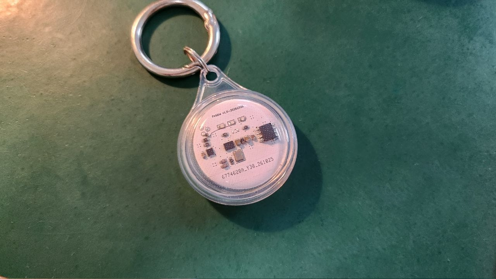
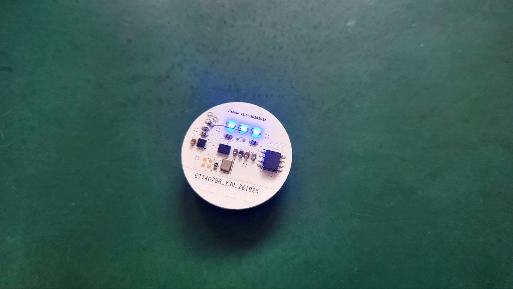
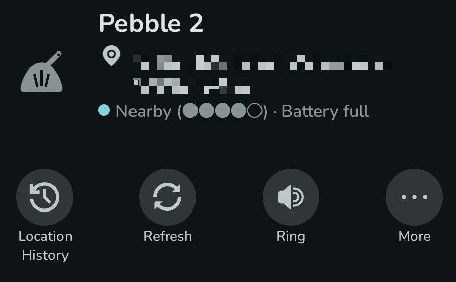

# Pebble

An another BLE tracking tag.



Pebble broadcasts in the OpenHaystack format and uses Apple's Find My network for location reports. This project also provides a modified version of OpenTagViewer for Android devices, which fixed the -80045 rejection error returned by Apple GSA.

## IC Design

| Component                         | Purpose                                                                                                                             |
| --------------------------------- | ----------------------------------------------------------------------------------------------------------------------------------- |
| Renesas **DA14531-00000FX2**      | BLE 5.1 SoC for Find My advertising, power management, and battery voltage measurement                                              |
| ST **LIS2DW12TR**                 | Low-power three-axis accelerometer connected over I²C for shake detection and interrupt wakeup                                      |
| (Optional) Winbond **W25X20CLSN** | 2 Mbit SPI Flash for boot firmware; marked DNP (do not populate) in the current BOM. The DA14531's internal OTP can be used instead |

The [hardware/](hardware/) directory contains the [schematic PDF](hardware/Pebble.pdf), KiCad design files, [BOM](hardware/Pebble.csv), and [Gerber files](hardware/gerber/).

## Usage

### 1. Set Up the Development Environment and SDK

Install [PlatformIO Core](https://docs.platformio.org/en/latest/core/installation/index.html) 6.1 or later and [Go](https://go.dev/dl/) 1.25 or later. A CMSIS-DAP SWD programmer is required for uploading firmware.

The Renesas SDK is not included in this repository. Download and extract it separately:

1. Open the [Renesas DA14531 product page](https://www.renesas.com/en/products/da14531) and find **DA145xx SDK 6.0.24.1464** under software and tools. Sign in if prompted and download `SDK_6.0.24.1464.zip`.
2. Place the ZIP in `firmware/platforms/da14531/vendor/` and extract it there. Run this command from the repository root:

   ```sh
   unzip firmware/platforms/da14531/vendor/SDK_6.0.24.1464.zip -d firmware/platforms/da14531/vendor/
   ```

3. Preserve the archive's directory structure. The extracted files should look like this:

   ```text
   firmware/platforms/da14531/vendor/
   ├── SDK_6.0.24.1464.zip
   └── DA145xx_SDK/
       └── 6.0.24.1464/
           ├── sdk/
           │   └── platform/include/da14531.h
           └── config/
               └── toolbox_resources/DA1453x/common/jtag_programmer_531.bin
   ```

The default SDK path is configured in [firmware/platformio.ini](firmware/platformio.ini):

```ini
custom_sdk_dir = platforms/da14531/vendor/DA145xx_SDK/6.0.24.1464
```

If you store the SDK elsewhere, update `custom_sdk_dir` to point to the version directory containing both `sdk/` and `config/`. Relative paths are resolved from `firmware/`.

### 2. Generate Your Find My Keys

Run from the repository root:

```sh
cd firmware/tools/findmy-keygen
go run . -p pebble
cp output/pebble/pebble_findmy_key.h ../../include/findmy_key.h
cd ../../..
```

- `pebble_findmy_key.h`: Public advertising key; copy it into the firmware before rebuilding.
- `pebble.keys`: Key file to import on Android.
- `pebble_devices.json`: Device file for Macless Haystack and compatible tools.

Files are saved to `firmware/tools/findmy-keygen/output/pebble/`. Use a separate key for each tag. The tool refuses to overwrite an existing output directory, so choose another `-p` name for subsequent tags. Keep the `.keys` and JSON files private: they contain private keys. The firmware currently broadcasts a single fixed key without rotation.

### 3. Build and Upload

Power the board and connect the CMSIS-DAP programmer's GND, SWCLK, and SWDIO to **TP1, TP2, and TP3**, respectively. SWD remains available for approximately **10 seconds after startup** before low-power sleep disables it. If the programmer cannot connect, power-cycle the board and retry.

Select an environment for your hardware. Each command builds and uploads the firmware:

| Environment | Command (from the repository root)               | Use case                                                                            |
| ----------- | ------------------------------------------------ | ----------------------------------------------------------------------------------- |
| SRAM        | `pio run -d firmware -e da14531_sram -t upload`  | Temporary development runs; lost on power-off; no external Flash required           |
| SPI Flash   | `pio run -d firmware -e da14531_flash -t upload` | Persistent, rewritable firmware; requires a populated W25X20CL; default environment |
| OTP         | `pio run -d firmware -e da14531_otp -t upload`   | Internal one-time-programmable memory for finalized firmware                        |

The OTP environment defaults to `custom_otp_confirm = no`, which checks the OTP without writing it. To program it permanently, change this value to `i_understand_otp_is_permanent` before uploading. The programmed firmware and key cannot be replaced afterward.

### 4. Operation and LED Indicators



- **Startup:** All three LEDs blink 10 times after the accelerometer initializes successfully.
- **Battery check:** Shake continuously for about 5 seconds. The LEDs show the battery level for about 5 seconds: all three at 2.9 V or above, yellow and red from 2.8 V to below 2.9 V, and red only below 2.8 V.
- **Nearby finding:** Tap **Ring** in OpenTagViewer to blink all three LEDs for about 10 seconds. Pebble responds with flashing LEDs; the board has no buzzer.

## Android Viewer

Use [OpenTagViewer](https://github.com/parawanderer/OpenTagViewer). This repository includes an [arm64-v8a debug APK](firmware/tools/OpenTagViewer-6100a00-arm64-v8a-debug.apk) for Android devices with ARM64 support.

1. Install the APK, sign in with an Apple account that has two-factor authentication enabled, and complete verification.
2. Transfer the generated `pebble.keys` file to your phone.
3. In the map or device list menu, select **Add OpenHaystack key (.keys)**, choose the file, and name the tag. Pebble uses user-generated keys, so it must be imported manually rather than discovered through iCloud.
4. Grant the requested Bluetooth permissions. When near the tag, view its signal strength and battery status or tap **Ring** to trigger the LEDs.



In the screenshot, **Nearby** means the phone detected the tag over Bluetooth. The dots indicate signal strength, and **Battery full** is the battery status carried in the advertisement. Use **Location History** to view past locations, **Refresh** to fetch location updates, and **Ring** to blink the tag's LEDs.

Remote location reports come from nearby Apple devices through the Find My network; update timing depends on surrounding devices and network conditions. Bluetooth detection and nearby finding require the phone to be within range of the tag.

## Changes

### Firmware

- Based on the Renesas SDK's `ble_app_noncon` example, with Pebble board configuration, PlatformIO integration, and CMSIS-DAP uploads to SRAM, SPI Flash, and OTP.
- Adds OpenHaystack advertising and a key generation tool, while keeping advertising connectable so DULT control commands can trigger LED finding.
- Adds LIS2DW12 interrupt wakeup, sustained shake detection, and low-power sleep. Battery indicators and advertisements reflect measured voltage; connection timeouts and advertising recovery help keep the tag discoverable.

### OpenTagViewer

This modified OpenTagViewer build draws on [sacca97/os-findmy-e](https://github.com/sacca97/os-findmy-e) for Mac/CoreADI emulation, Apple sign-in fixes, and CloudKit compatibility. Its native CoreADI implementation is a C++ port of that project's Rust `adi-core`.

The bundled APK is based on `6100a00` ([PR #274](https://github.com/parawanderer/OpenTagViewer/pull/274)). A [patch from `f5b09f7` to that revision](firmware/tools/OpenTagViewer-f5b09f7-to-pr274-6100a00.patch) is included. Its main changes are:

- Runs CoreADI through a Unicorn-based Mac emulator to generate Anisette data locally for new sign-ins, while preserving the original authentication provider for existing sessions.
- Fixes two-factor authentication handling when Apple returns `hsc = 409` during sign-in.
- Fixes compatibility between the emulated Mac's device identifier and CloudKit's UUID requirements.
